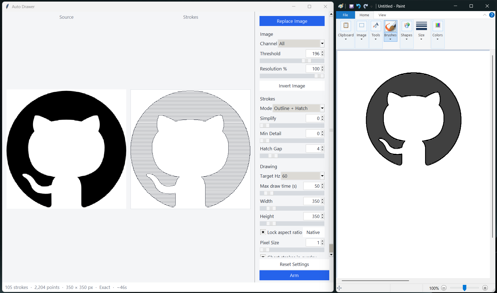

# Auto Drawer

[](https://github.com/vicromao/AutoDrawer/actions/workflows/ci-cd.yml)
[](https://github.com/vicromao/AutoDrawer/releases/latest)
-0078D4)

Auto Drawer redraws any image with mouse automation, in any app that allows freehand drawing, such as Microsoft Paint, Roll20, and online whiteboards. It traces continuous strokes with OpenCV instead of painting pixel by pixel, so a drawing costs a handful of strokes instead of hundreds of objects on the canvas.



> [!NOTE]
> Mouse automation goes through X11: on Wayland sessions only XWayland applications can be drawn into. On Linux the global Esc/F9 hotkeys need root, because the `keyboard` library reads input devices directly.
> macOS may work but is untested.

## Features

- Traces continuous strokes with OpenCV, with one mouse-down per contour instead of one drag per pixel run
- Outline mode, or outline plus a serpentine hatch fill
- Pacing matched to the target's sampling rate, so the drawing matches the preview
- Honest preview: if the drawing must be reduced to fit the time budget, the preview shows the reduced result
- Placement overlay follows the cursor and shows exactly what will land where
- Live stroke/point counts and estimated drawing time
- Esc or a screen corner cancels mid-drawing; a cancelled drawing disarms itself
- Settings persist between runs

## Requirements

- Python 3.8+
- A target application with freehand mouse drawing (Paint, Roll20, ...)
- On Linux: an X11 session, and root for the global hotkeys

## How to use

```bash
pip install -r requirements.txt
python AutoDrawer.py
```

1. **Load an image** and adjust Threshold and Resolution until the preview looks clean. Dark areas are what gets traced.
2. **Pick the stroke settings**: `Outline` is lightest, `Outline + Hatch` adds a fill. The strokes/points readout is how many objects the target app will create.
3. **Set Target Hz** to how fast the target samples the mouse (60 for a typical browser) and **Max draw time** to what you are willing to spend. Auto Drawer paces itself to one point per frame; if that would exceed the budget, it sheds invisible points first and only then reduces fidelity. The preview always shows what will actually be drawn.
4. **Click Arm**, point at the target, and press **Enter** (or **F9** from anywhere when global hotkeys are available). **Esc** or a quick move to a screen corner cancels and disarms.

## Development

The stroke pipeline, pacing model, and settings logic are headless, so no display or mouse is needed:

```bash
python -m unittest discover -s tests -t . -v
```

CI runs the compile check and the test suite on every push and pull request; pushing a `v*` tag publishes a release with a source archive and checksums.

## Credits

Fork of [ChristopherBaim/AutoDrawer](https://github.com/ChristopherBaim/AutoDrawer) by Christopher Baim, replacing the raster fill with an OpenCV stroke pipeline.
